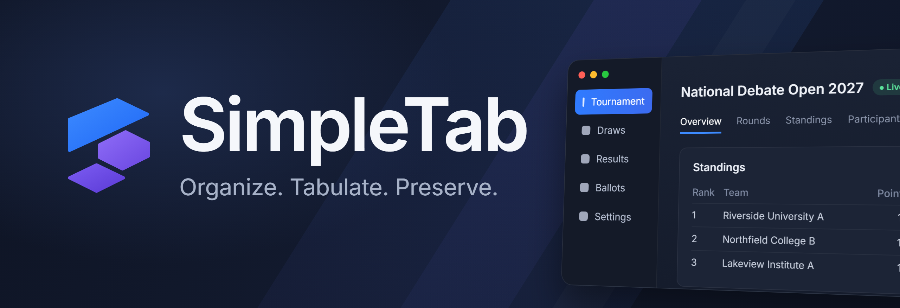

<p align="center">
  
</p>

<p align="center">
  <b>Offline-first debate tabulation for British Parliamentary and two-team formats.</b><br>
  One laptop runs the whole tournament. Everything online is optional, and free.
</p>

<p align="center">
  <a href="docs/designs/simpletab.md">Design</a> ·
  <a href="https://github.com/The-Studio-of-Sadiq/simpletab-public">Public results site</a> ·
  <a href="docs/brand/README.md">Design system</a> ·
  <a href="LICENSE">AGPL-3.0</a>
</p>

---

## Why SimpleTab

- **Runs with no internet.** The host laptop holds the tournament and keeps tabbing when the venue Wi-Fi fails.
- **Fair and reproducible.** Draws, allocations and standings are deterministic, and every change is recorded in a hash-chained change log that anyone can verify.
- **Free to run.** Online ballots, the public results site and the permanent archive all fit free tiers (Cloudflare, GitHub Pages).
- **Built for the tab room.** Colleagues' laptops pair over the local network with a code and six matching words. Live editing from those laptops, each limited to its role, arrives with M5.
- **English and Bangla**, with a template for adding more languages.

## What is in this repository

The desktop app and the shared tournament logic. The ballots service (`simpletab-ballots`) and the [public results site](https://github.com/The-Studio-of-Sadiq/simpletab-public) live in their own repositories.

| Path | What it is |
|---|---|
| `packages/core` | `@simpletab/core`: draws, adjudicator allocation, ballots, standings, break, CSV, public projection, permissions, ops and the change log. Runs in Electron, Workers and browsers. |
| `packages/host` | The host backend: the tournament engine on SQLite, sync with the ballots service, publishing, the GitHub archive and live collaboration. |
| `packages/tab-ui` | The tab screens (React inside Theia). |
| `packages/app` | The Theia desktop application (Electron). |
| `docs/designs/` | The approved design and its amendments. |
| `docs/brand/` | Logo, colours, type and the README banner. |

## Status

Milestones M0–M4 are built: the core port, offline tabbing end to end, the git panel, online ballots, and publishing with the permanent GitHub archive. M5 (live collaboration and host takeover) is in progress. See the [design](docs/designs/simpletab.md) for the full plan.

## Development

Node 22 or newer, Windows first.

```sh
npm install
npm test                          # Vitest
npm run lint                      # ESLint and TypeScript
npm run build -w packages/app     # build the desktop app
npm start -w packages/app         # run it
```

## Licence

AGPL-3.0-or-later. See [LICENSE](LICENSE). Portions are derived from CrabbyTab. Inter is used under the SIL Open Font License 1.1.
