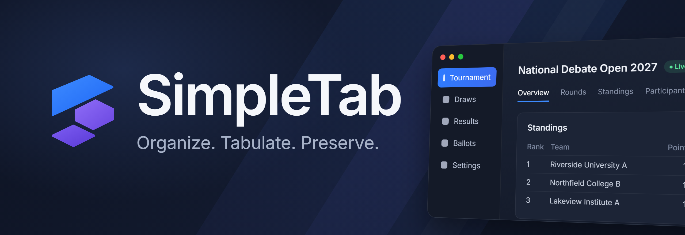

# SimpleTab design system

Premium, professional, clean and minimal: a navy or soft-white base, one blue and one violet accent, Inter, generous spacing and quiet borders. Colour is never the only signal; text always carries the meaning.

## Logo

| File | Use |
|---|---|
| [`logo-mark.svg`](logo-mark.svg) | The mark in colour: a blue slab over a violet hexagon and a violet base. |
| [`logo-mark-mono.svg`](logo-mark-mono.svg) | One-colour mark (ink) for print, stamps and tiny sizes. |
| [`logo-wordmark.svg`](logo-wordmark.svg) | Mark and name, for light backgrounds. |
| [`app-icon.svg`](app-icon.svg) | The mark on a dark rounded tile. Rendered to `packages/app/resources/icons/` for the window and installer. |
| [`banner.png`](banner.png) | README and social banner (2560 × 880). Source: [`banner.html`](banner.html). |

Keep clear space around the mark of at least half its width. Do not recolour, rotate, outline or add effects to it.

## Colour

| Token | Value | Use |
|---|---|---|
| `--st-blue` | `#2F7BFF` | Primary actions, focus, active tab underline |
| `--st-blue-strong` | `#1E66F5` | Hover and pressed |
| `--st-violet` | `#7C5CF2` | Secondary accent: progress, badges, activity |
| `--st-ink` | `#151B2B` | Text on light, dark surfaces |
| `--st-mist` | `#E8EAF0` | Light neutral |
| `--st-gradient` | `#3D8BFF → #7C5CF2` | The mark and hero moments only, never body UI |

Dark theme surfaces run from `#0C111D` (chrome) through `#111727` (pages) to `#161E30` (cards and inputs). The light theme uses `#F6F7FA` pages and white cards with `#E4E7EE` borders.

## Type

Inter (variable, 100–900), bundled with the app so it works offline. Bangla text falls back to the system's Bengali font (Nirmala UI on Windows, Noto Sans Bengali elsewhere).

| Style | Size / weight |
|---|---|
| Page title | 22 px / 650, −0.02 em |
| Section title | 15 px / 620 |
| Body | 13.5 px / 400, line height 1.5 |
| Table header | 11.5 px / 600, uppercase, +0.06 em |

## Shape and spacing

Radii are 6 px (small), 8 px (buttons and inputs) and 12 px (cards). Pages use 28–32 px padding and cards 20–22 px. Shadows are soft and low. Focus is a 3 px blue ring.

## In the code

- `packages/tab-ui/src/browser/style/simpletab-brand.css`: the tokens and their mapping onto Theia's theme variables (dark and light).
- `packages/tab-ui/src/browser/components/brand-mark.tsx`: the mark as a React component.
- `packages/app/resources/splash/`: the start-up splash screen.

Inter is licensed under the SIL Open Font License 1.1; the licence is next to each copy of the font files.
